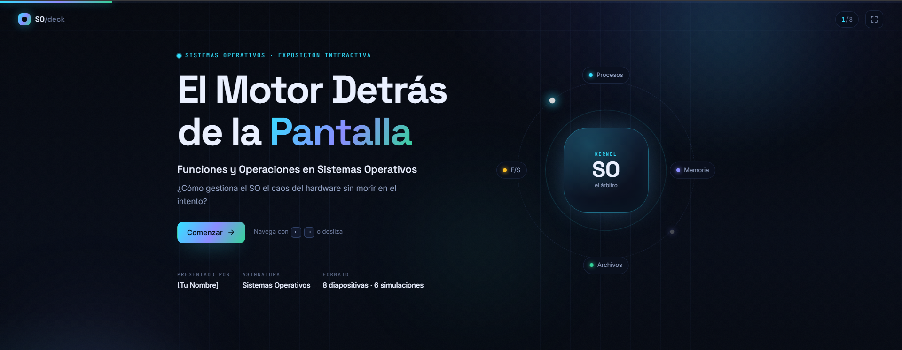

<div align="center">


# El Motor Detrás de la Pantalla

**Funciones y operaciones de los Sistemas Operativos**

Una presentación web interactiva que explica cómo el sistema operativo gestiona el caos del hardware: procesos, memoria, archivos, seguridad y concurrencia. Ocho diapositivas y seis simuladores que puedes ejecutar en vivo.


</div>

---

## Vista previa

<p align="center">
  
</p>

> Una diapositiva, un concepto. Cada tema termina en un simulador que puedes tocar, romper y reiniciar.

---

## Lo que incluye

| Característica | Detalle |
|---|---|
| **Diapositivas** | 8, con navegación tipo deck |
| **Simuladores** | 6, escritos en JavaScript puro |
| **Dependencias** | Ninguna |
| **Build** | No requiere compilación |
| **Controles** | Teclado, botones, puntos de navegación y swipe |
| **Diseño** | Responsive, modo oscuro, animaciones y `prefers-reduced-motion` |

---

## Simuladores interactivos

### 1. Llamadas al sistema
Recorre el viaje de una llamada `fork()`, `read()`, `write()` o `chmod()`: del **modo usuario** al **modo kernel**, pasando por la instrucción `trap`, el hardware y el retorno.

### 2. Planificación de CPU
Compara **FIFO**, **SJF** y **Round Robin** con quantum ajustable. Genera un diagrama de Gantt y calcula espera media, tiempo de retorno medio y cambios de contexto.

### 3. Cambio de contexto
Observa cómo el planificador guarda y restaura el **PCB** de dos procesos, actualizando `PC`, `SP` y registros entre cada cambio.

### 4. Condición de carrera
Dos hilos incrementan un contador compartido. Activa o desactiva el **mutex** y compara cuántas actualizaciones se pierden.

### 5. Paginación y memoria virtual
Simula accesos a páginas con solo 4 marcos disponibles. Visualiza fallos de página, reemplazos **FIFO** y **LRU**, hits y tasa de aciertos.

### 6. Permisos de archivos
Construye permisos `rwx` para propietario, grupo y otros. Obtén al instante el valor **octal**, la notación **simbólica** y el comando `chmod` equivalente.

---

## Contenido de la presentación

1. **Portada** — El motor detrás de la pantalla
2. **Introducción** — ¿Qué hace realmente un sistema operativo?
3. **Funciones** — Gestión de procesos, memoria, archivos y abstracción del hardware
4. **Llamadas al sistema** — El puente entre el programa y el kernel
5. **Procesos y concurrencia** — Planificación, cambio de contexto y sincronización
6. **Memoria virtual** — Paginación, fallos de página y swap
7. **Archivos y seguridad** — Sistemas de archivos y permisos
8. **Conclusiones** — El héroe invisible

---

## Cómo ejecutarlo

No necesita instalación ni servidor: es HTML, CSS y JavaScript puro.

```bash
# Opción 1: abrir el archivo directamente
# Windows
start index.html
# macOS
open index.html
# Linux
xdg-open index.html
```

```bash
# Opción 2: servidor local (recomendado para probar todo)
python -m http.server 8000
```

Luego abre `http://localhost:8000` en tu navegador.

---

## Controles

| Acción | Tecla o gesto |
|---|---|
| Siguiente | `→`, `PageDown` o `Espacio` |
| Anterior | `←` o `PageUp` |
| Primera / última diapositiva | `Home` / `End` |
| Pantalla completa | `F` |
| Ir a una diapositiva | Clic en los puntos inferiores |
| Móvil | Desliza horizontalmente |
| Enlace directo | Añade `#3` a la URL |

---

## Estructura del proyecto

```text
lamar_sistemas_operativos/
├── index.html              # Estructura y contenido de las 8 diapositivas
├── assets/
│   ├── favicon.svg         # Icono del sitio
│   └── web.PNG             # Captura usada en este README
├── css/
│   └── styles.css          # Diseño, animaciones y responsive
└── js/
    ├── deck.js             # Navegación, teclado, swipe y pantalla completa
    ├── sims.js             # Tabs, acordeón y simulador de llamadas al sistema
    ├── scheduler.js        # Planificación FIFO / SJF / Round Robin
    ├── concurrency.js      # Cambio de contexto y condición de carrera
    ├── memory.js           # Paginación con reemplazo FIFO y LRU
    └── permissions.js      # Permisos chmod en octal y simbólico
```

---

## Tecnologías

| Capa | Uso |
|---|---|
| **HTML5** | Estructura semántica y accesible de las diapositivas |
| **CSS3** | Variables, gradientes, animaciones, grid/flex y media queries |
| **JavaScript** | Simuladores y navegación sin frameworks ni librerías |
| **Google Fonts** | Inter, Space Grotesk y JetBrains Mono |
| **SVG** | Iconos, ilustraciones y favicon |

---

## Personalización

- **Datos de la portada** — edita el bloque `.cover-meta` en `index.html`.
- **Colores y tipografía** — ajusta las variables de `:root` en `css/styles.css`.
- **Simuladores** — los parámetros iniciales están al inicio de cada archivo en `js/`.

---

<div align="center">

**Proyecto académico · Sistemas Operativos**

**Autores:**
- Pablo Arturo García Gutiérrez · 000053276
- Moises Baldenegro Melendez · 000053466

**Institución:** LAMAR · Campus Chapultepec

</div>
